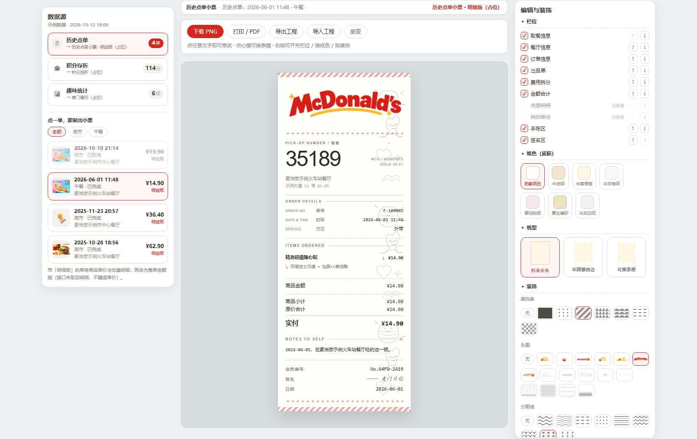
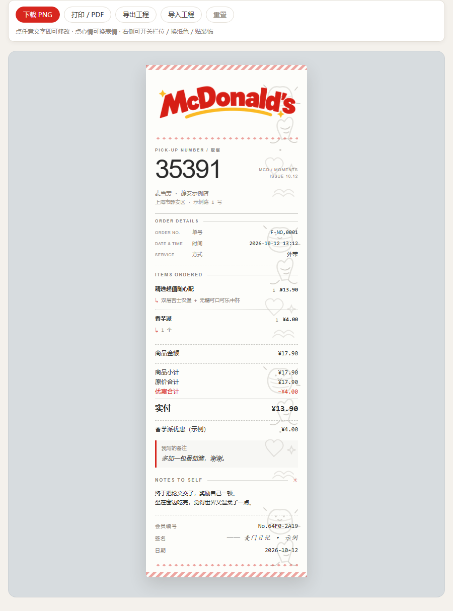
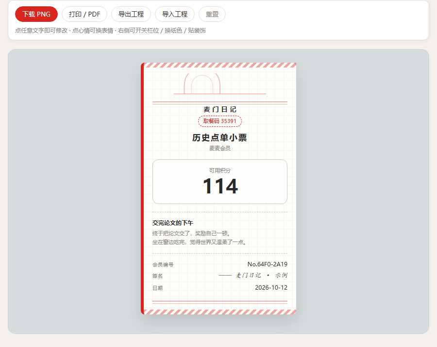
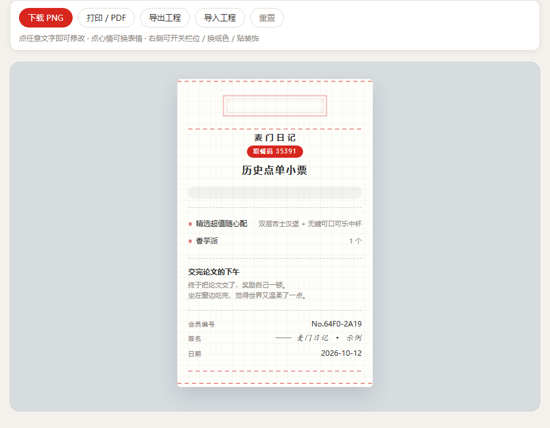

# 麦门日记 · 文创小票生成器

> **MaiMen Diary** — a McDonald's MCP powered receipt studio.
>
> 手账本里，值得有一张今天的小票。



**「把我吃过的麦当劳做成小票。」**

一句话，WorkBuddy 通过**麦当劳 MCP** 拉出你的真实订单明细，在**三栏工作台**里挑一条数据，
做一张**可编辑、可装饰、可下载打印**的手账向创意小票。

[先看效果](#先看效果) · [在线体验](#快速开始) · [能做出哪些小票](#能做出哪些小票) · [怎么用](#快速开始) · [MCP 怎么接的](#mcp-接入) · [参赛材料](#参赛材料)

> ⚠️ **本项目为麦当劳程序员节创意开发大赛参赛作品，由参赛者独立开发，非麦当劳官方产品。**
> 生成的小票为**创意虚构产物**，仅用于个人手账与文创创作，**不可用作任何真实消费凭证**。

---

## 30 秒看懂

```
你：把我吃过的麦当劳做成小票

麦门日记：📡 通过麦当劳 MCP 拉取你的真实档案
          ✅ 4 单历史订单（每一单都带明细）· 114 积分 · 6 项趣味统计

          ┌── 数据源 ──┬── 小票舞台 ──┬── 编辑与装饰 ──┐
          │ 历史点单 4 │  点字即改     │ 栏位 / 纸色 / 纸形 │
          │ 积分存折 114│              │ 装饰 / 明细 / 文案 │
          └───────────┴──────────────┴────────────────┘

          「2026-06-01 午餐 ¥14.90」→ 点一下就生成明细版小票
          品项 · 单价 · 优惠 · 取餐码 · 我自己写的备注，全在里面

          还能：换个纸色 · 换个纸形 · 贴个装饰 · 下载 PNG（3 倍清晰度）
```

**打开就是自己的麦门档案** —— 数据在交付前就已全部内嵌，页面是**静态快照**（产物里的 `fetch` / `XHR` 出现 0 次），
双击即用、**不需要 Token、不需要联网、不需要装任何东西**。

---

## 先看效果

三张成品（均由仓库根目录的 `index.html` 直接生成，示例数据、门店为虚构）：

| 历史点单小票 · 明细版 | 积分存折 | 麦门履历（趣味统计） |
|---|---|---|
|  |  |  |
| 品项 / 单价 / 优惠合计 / 取餐码 / 我的备注 | 累计与已过期积分、能换几个巨无霸 | 门店足迹 / 常点 TOP / 饭点分布 / 跨度天数 |

> 视觉目前为**结构占位级**：版式层次、栏位、装饰槽都是真的，美术正式版式仍在接入中。
> 这也意味着**二次开发成本很低** —— 换一套 `template.html` + `template.css` 就是一套全新小票（见[模板开发](#模板开发给设计师--二次开发)）。

---

## 能做出哪些小票

| 小票 | 数据来源 | 情绪钩子 |
|---|---|---|
| **历史点单小票 · 明细版** | `order-list` → `query-order` | 展示品项、数量、真实行金额；有套餐详情时再展开，取餐码和我自己写的订单备注按数据展示。缺少明细时降级为整单金额版式并明示 |
| **积分存折** | `query-my-account` | 累计积分 ≈ 能换几个巨无霸；**已过期积分**单独成行 |
| **麦门履历（趣味统计）** | 纯计算 | 门店足迹 / 最贵一单 / 常点 TOP / 饭点分布 / 时间跨度 |

> 当前只保留三类常用数据源。活动、联名周边、战利品已于 2026-10-14 从工作台和正式构建入口退役；
> 旧模板与维护说明归档在 `archive/retired-data-sources/`（**仅本地留档，不随仓库发布**），不参与 CLI、工作台与正式构建。

## 三个关键差异

| | 常见做法 | 麦门日记 |
|---|---|---|
| **数据** | 用户自己整理订单 | MCP 直接拉，**零导入**；`query-order` **交付前逐单拉齐**，打开即是完整档案 |
| **明细** | 只给整单金额 | **`query-order` 拿到单项原价 + 优惠明细 + 取餐码 + 我的订单备注** |
| **编辑** | 只能改文字 | **栏位开关 / 换纸色 / 换纸形 / 贴装饰 / 增删明细行 / 插文案** |

## 目标用户

| 人群 | 用途 |
|---|---|
| 手账 / 拼贴 / 文创爱好者 | 快速获得可打印、可装饰的小票素材，贴进本子 |
| 麦门粉丝 | 记录"我吃过的那些顿"，晒图有梗 |
| 想纪念一顿饭的普通人 | "第一次带娃吃麦麦""考完试那顿" |

---

## 快速开始

### 方式一：在线体验（零安装、零 Token）

**🌐 <https://lengxi-c.github.io/mcd-receipt-studio/>**

页面是**静态快照**，浏览器打开即可点选数据、改栏位、换纸色纸形、贴装饰。
（仓库已开启 GitHub Pages；若该链接尚未生效，用下面的方式二。）

### 方式二：下载后双击打开

```bash
git clone https://github.com/lengxi-c/mcd-receipt-studio
cd mcd-receipt-studio
start index.html          # Windows
open  index.html          # macOS
```

内置示例数据集，开箱即用：左侧数据源、中间小票舞台、右侧编辑与装饰面板，全部可交互。

### 方式三：用你自己的真实数据生成

1. 申请麦当劳 MCP Token：<https://open.mcd.cn/mcp>（手机号登录 → 控制台 → 激活）
2. 复制 `mcp-config.example.json` 为 `mcp-config.local.json`，替换 `${MCD_MCP_TOKEN}`
   （**已在 `.gitignore` 中，不会被提交**）
3. 在 WorkBuddy / Cherry Studio / Cursor 等 MCP Client 中启用 `mcd-mcp`
4. 对 Agent 说一句话：

```
把我吃过的麦当劳做成小票
```

Agent 会按 [`SKILL.md`](./SKILL.md) 的流程：拉 `order-list` → **对每一单调 `query-order`** → 组装数据集
→ `node cli.js build --workspace` 生成三栏工作台页面。

### 方式四：命令行（开发者）

零依赖，只需 Node ≥ 18：

```bash
node cli.js selftest                                    # 一键自检
node cli.js list                                        # 列出模板
node cli.js check                                       # 契约检查（数据 / 数据集 / 映射 / 模板）
node cli.js check --dataset examples/real-dataset.json  # 拿真实数据跑契约检查
node cli.js build --all                                 # 构建工作台 + 各模板 + 画廊
node cli.js build --all --dataset examples/real-dataset.json   # 用真实数据构建全部产物
node cli.js build --workspace --dataset my-data.json    # 用你的数据集构建工作台
node cli.js build --template starter-classic --data my-receipt.json --out out.html
node cli.js validate --data my-receipt.json             # 校验一份小票数据
```

---

## 交互结构

```
┌──── ① 数据源 ────┬──────── ② 小票舞台 ────────┬──── ③ 编辑与装饰 ────┐
│ 3 个入口（固定）  │  面包屑：当前小票 × 数据   │ ▸ 栏位  ☑抬头 ☑出品单 │
│  ① 历史点单       │                            │        ☑金额 ☑手账区  │
│  ② 积分存折       │      ┌────────────┐        │ ▸ 纸色  ○热敏 ●牛皮纸 │
│  ③ 趣味统计       │      │  点击即编辑 │        │ ▸ 纸形  ○标准 ○锯齿  │
│                   │      └────────────┘        │ ▸ 装饰  6 类槽位      │
│                   │  缩放 100%  PNG  打印  重置│ ▸ 明细  行可增删      │
│                   │                            │ ▸ 文案  语录一键插    │
└───────────────────┴────────────────────────────┴───────────────────────┘
```

**票面分层（开箱即有层次，不必等美术）**：

```
票头  装饰条 → 创意头图 → 分割线 → 字标「麦门日记」→ 门店 → 地址 → 徽标
正文  单号时间 → 出品单 → 费用 → 金额 → 优惠 → 备注 → 手账
签名  印章 / 会员编号（真实 accountId 派生 No.XXXX-XXXX）/ 落款 / 日期 / 积分
票尾  分割线 → 尾图收边
全局  水印铺满整票
```

6 类装饰槽各自带默认素材（`manifest.defaultDeco`），不挑就有层次；一挑即换成自己的选择。
「本来就可能没数据」的栏位（如优惠明细）带 `data-block-require`：数据里没有时票面自动隐藏，
右栏开关**灰显 + 标注「无数据」**，点不动。

**诚实边界**（写进了界面）：

- **单价只从 `query-order` 取真实值**；若未取到详情，小票自动降级为整单金额版式并明示，绝不按总价反推分摊；
- 收件人昵称 / 地址 / 手机号默认**不印在小票上**；
- **MCP 拿不到"用户名"**（接口只给 `accountId` 与订单字段）。签名区的「会员编号」是 `accountId` 派生的真实编号，
  不是编造的昵称；落款留给你自己写。

---

## 项目结构

```
.
├─ index.html                  # 工作台产物（三栏，双击即用 · 静态快照）
├─ cli.js                      # CLI：list / check / build / validate / selftest
├─ SKILL.md                    # Agent 工作流：怎么拉数据、怎么生成
├─ src/
│  ├─ engine.js                # 渲染引擎：填充 / 编辑 / 金额联动 / 栏位 / 皮肤 / 装饰 / 导出
│  ├─ engine.css               # 引擎级样式（工具条、舞台、编辑态、打印）
│  ├─ mappers.js               # 数据集 → 小票 的映射逻辑（UMD 共享层）
│  ├─ panel.js                 # 三栏工作台（数据源 + 舞台 + 编辑装饰）
│  ├─ panel.css                # 面板样式（占位级，待美术接入）
│  ├─ builder.js               # 产物构建器 + 全部契约校验
│  ├─ receipt.schema.json      # ★ 小票数据契约
│  ├─ dataset.schema.json      # ★ 数据集契约
│  ├─ decor.schema.json        # ★ 素材包契约（皮肤 / 装饰）
│  ├─ decos/                   # 皮肤预设 + 装饰素材（原创内联 SVG + 品牌头图 PNG · 6 类槽位）
│  └─ vendor/                  # 可选：本地 html2canvas（离线导出 PNG）
├─ templates/                  # ★ 一套小票 = 一个文件夹
│  ├─ index.json               # 模板注册表（共 7 套）
│  ├─ order-receipt/           # 专属①：历史点单小票 · 明细版
│  ├─ points-passbook/         # 专属②：积分存折
│  ├─ fun-resume/              # 专属③：麦门履历
│  └─ starter-*/               # 兜底模板（4 套，契约示例 / 极简风备选）
├─ examples/
│  ├─ demo-data.json           # 示例小票数据
│  ├─ demo-dataset.json        # 示例数据集（结构取自真实 MCP 实测）
│  └─ real-dataset.json        # ★ 真实数据集（2026-10-12 实拉 4 单，已脱敏）
├─ assets/                     # README 演示图
├─ README.md
├─ MCP_INTEGRATION.md          # MCP 使用说明（启用工具 / 调用流程 / 数据边界）
├─ CONTEST_DECLARATION.md      # 参赛声明（官方原文件）
├─ TEMPLATE_GUIDE.md           # 模板接入契约（data-field / data-block / data-slot）
├─ PLACEHOLDERS.md             # 美术占位登记表
├─ mcp-config.example.json
└─ workbuddy.md                # WorkBuddy 开发过程记录（需求原话 / 决策 / 缺陷定位 / 联调）
```

## 模板开发（给设计师 / 二次开发）

模板与引擎**完全解耦** —— 新增一套小票只需新建一个目录：

```
templates/my-design/
├─ manifest.json     # 元信息（id / name / status / 尺寸 / 导出参数 / defaultDeco）
├─ template.html     # 结构（data-field 取数 / data-block 栏位 / data-slot 装饰槽 / 头尾分层）
└─ template.css      # 视觉（以 .rct-scope--my-design 为作用域根，颜色走 CSS 变量）
```

在 `templates/index.json` 登记一行，跑 `node cli.js selftest` 检查契约即可。

**三层可换模型**：骨架（模板）→ 纸色皮肤（CSS 变量）→ 装饰（槽位素材），
用户能在不改模板的前提下换纸色、贴装饰、开关栏位。
模板可用 `manifest.defaultDeco` 给每个装饰槽配默认素材，保证**占位状态下票面就有层次**。

- **完整字段规范**：[`TEMPLATE_GUIDE.md`](./TEMPLATE_GUIDE.md)
- **待设计位置清单**：[`PLACEHOLDERS.md`](./PLACEHOLDERS.md)

### 写模板必须知道的几条（违反会被 `check` 拦下）

| 约束 | 原因 |
|---|---|
| 字体栈必须含**显式中文字体名**，末尾才能收泛型 | 导出走 `html2canvas`，它会给 `font-family` 每段加引号，泛型被引号化后不再按泛型解析 → 中文回退、字宽变化 |
| 禁用 `mask` / `clip-path` | `html2canvas` 会**静默忽略**它们：页面轮廓剪得好好的，导出的 PNG 回到矩形硬边。圆角用 `border-radius`，异形轮廓用内联 SVG |
| 模板不得出现 `` / 引用 `image` 字段 | 合规红线：官方商品图只允许出现在左栏数据卡片，不上票面 |
| 同一父容器下的 `data-block` 必须同级 | 引擎靠同级重排实现栏位排序，嵌套会失效 |
| 同一业务规则只能有一份实现 | 两个调用方都要用的判定一律下沉到 `mappers.js`，禁止复制粘贴 |

---

## 工程质量

项目自带**六段门禁**，每一段都跑在真实产物上（前四段逻辑与契约，**第 5 段量页面、第 6 段量导出图**）：

| # | 门禁 | 覆盖 |
|---|---|---|
| 1 | `node cli.js check` | 契约校验 5 段（数据 / 数据集 / 映射 / 模板 / 素材，含合规静态守卫） |
| 2 | `node cli.js selftest` | 引擎 / 模板 / 数据集 / 选择器是否对齐 |
| 3 | `.devtest/smoke.js` | jsdom 冒烟 195 项（三栏交互 / 三层可换 / 边界与降级路径） |
| 4 | `.devtest/e2e.js` | 端到端 104 项（真实数据集 · **金额恒等式**） |
| 5 | `.devtest/shot.js` | 真实浏览器布局验收 40 项（无重叠 / 贴边 / 顺序，附截图落盘） |
| 6 | `.devtest/export.js` | 导出**像素**验收 33 项（导出图主色 / 轮廓是否被静默吃掉） |

> 第 5、6 段是本项目踩过坑之后才补的：`mask` / `box-shadow` 这类属性在页面里完全正确、
> 一进 `html2canvas` 就变样，只跑布局门禁**照不到**。这两类缺陷曾在六段门禁之外潜伏了三个版本。
> （门禁脚本属内部资产，不随仓库发布。）

## MCP 接入

实际使用的麦当劳 MCP Server 与 Tool、调用流程、数据边界，全部写在 **[`MCP_INTEGRATION.md`](./MCP_INTEGRATION.md)**。
公开配置示例 [`mcp-config.example.json`](./mcp-config.example.json) **只含 `${MCD_MCP_TOKEN}` 占位符**。

三条口径值得单独说明（都是实测出来的，不是文档推断）：

- **单价一律采信 `query-order`**：`order-list` 只有角精度（`62.9`），`query-order` 是分精度（`62.79`）；
- **平台总优惠 ≠ 券明细之和**（含运费减免），所以版式上并列「优惠合计」与「券明细」两层，不合并；
- **活动 / 联名周边没有"我获得过"的接口**，改用「一次 `order-list` + 关键词正向匹配」，
  界面明确标注「依据订单推断」，不假装是官方记录。

## 参赛材料

| 官方要求 | 本仓库 |
|---|---|
| 项目介绍 / 安装方法 / 使用示例 / 目标用户 | 本 README |
| 参赛声明（原创性 / 合规性 / 敏感信息） | [`CONTEST_DECLARATION.md`](./CONTEST_DECLARATION.md)（官方原文件，未改动） |
| MCP 接入说明（Tool / 调用流程 / 业务价值） | [`MCP_INTEGRATION.md`](./MCP_INTEGRATION.md) |
| 脱敏 MCP 配置示例 | [`mcp-config.example.json`](./mcp-config.example.json) |
| WorkBuddy 开发上下文 | [`workbuddy.md`](./workbuddy.md) |
| 可公开访问的 GitHub 仓库 | <https://github.com/lengxi-c/mcd-receipt-studio> |

## 合规与免责

- 本项目为**参赛作品 / 非官方产品**，与麦当劳及其关联方无隶属或代理关系，不代表麦当劳官方立场
- **装饰素材允许使用麦当劳官方品牌元素**（官方字标、金拱门、吉祥物、官方产品图等）作为可选美术方向，
  已内置在 `src/decos/`（含品牌头图 PNG 与官方商品图缩略图通道）。使用时请遵循麦当劳品牌使用规范，
  并保留本页与工作台页面级的「非官方产品」声明
- 生成物为**创意虚构小票**，**不可用于报销、维权或任何真实凭证用途**。
  票面不印免责文案，「非麦当劳官方出品」的提示放在**页面级**位置，不占用票面版式
- 唯一仍受限制的是：**不得把生成物做成可乱真的报销级凭证**（不加税号、发票号、公章等真实凭证元素）
- 真实 MCP Token 仅通过环境变量注入，仓库内不含任何凭证；示例数据中的订单号、手机号等已脱敏
- 装饰均为**内置预设素材**，页面**不提供任何用户上传**；所有数据全程只读，不向任何服务器发送内容
- 价格、门店、菜单等实时信息以麦当劳官方渠道为准

## 许可

项目代码以 MIT 许可发布；该许可不授予对麦当劳商标、字标及其他第三方品牌素材的使用许可。参赛声明见 [`CONTEST_DECLARATION.md`](./CONTEST_DECLARATION.md)。

## 参赛信息

- 赛事：麦当劳程序员节创意开发大赛
- 官方仓库：<https://github.com/M-China/mcd-developer-innovation-challenge>
- 开发工具：腾讯 WorkBuddy（全程）· 开发过程见 [`workbuddy.md`](./workbuddy.md)
